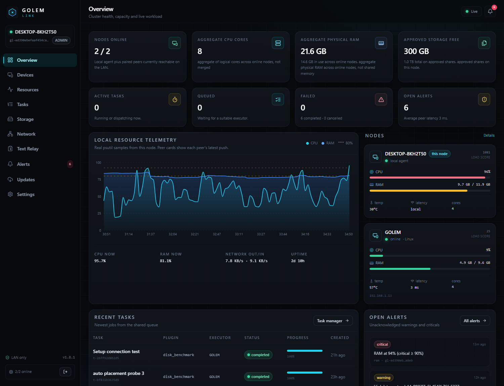
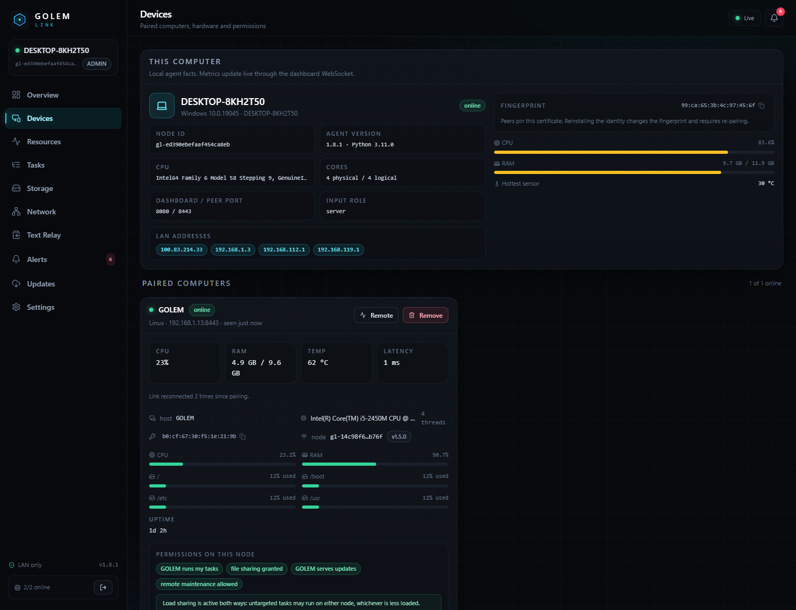

# GOLEM LINK 1.8.1

**Two machines on your LAN become one workstation — no cloud, no accounts, no telemetry.**




GOLEM LINK is a self-hosted control plane for two computers on the same local
network. A Debian 13 laptop and a Windows 10 desktop each run an independent
agent; there is no master node. One dark dashboard shows both machines side by
side, moves work to whichever is less busy, and relays copied text between
them. Everything travels over your own LAN, pinned to each node's certificate.



## What it actually does

| Area | Behaviour |
| --- | --- |
| **Telemetry** | Real CPU/RAM/disk/network samples every two seconds from each node, with GPU temperature when the platform exposes one. Aggregates are labelled as aggregates — nothing is presented as shared memory. |
| **Scheduling** | Submit a task with *Auto* and it runs on the least-loaded healthy machine. Balanced / local-first / remote-first policies, priorities with queue aging, timeouts, bounded retries, health checks, result sync and full task history. |
| **Host guard** | *Keep this machine light* offloads new work when CPU ≥ 55% or RAM ≥ 70% (editable). A sustained overload moves a running task at most twice, and the agent never touches processes it did not start. |
| **Tasks** | Built-in plugins (`file_hash`, `compress`, `image_resize`, `text_stats`, `disk_benchmark`) plus optional user Python, off by default and enabled per node. Heavy results (> 512 KB) travel over HTTPS instead of the WebSocket; > 4 MB is marked `truncated`, never silently cut. |
| **Storage** | Opt-in shares — never a whole drive by default — with read-only and delete controls, chunked resumable transfers, SHA-256 verification, progress and cancel. |
| **Text relay** | Send copied text to a paired machine and have it land on that desktop's clipboard. *Send to all* reaches every online device at once. Only text moves, capped at 256 KB, with an inbox and per-item errors. |
| **Input sharing** | Generates Deskflow / Input Leap configuration for left/right screens and clipboard, and reports whether the tool is installed or running. |
| **Remote ops** | Per-peer Remote panel: version, service state, uptime, resources, task counts, 300 lines of that node's log, restart and rollback. No shell, no arbitrary commands. |
| **Updates** | Check, download, verify (SHA-256 + size), stage, install, roll back and fleet-rollout from the dashboard or CLI. Windows installs unattended; Linux stages and shows one `sudo` command, or applies automatically through an opt-in root helper. |
| **Security** | scrypt password hashing, HMAC session cookies + CSRF token, admin/viewer roles, rate-limited login, audit log, LAN-only request guard, and per-peer grants enforced on the granting node. |

## Architecture

```text
┌───────────────────────────┐                 ┌───────────────────────────┐
│ Windows 10 desktop        │  pinned TLS     │ Debian 13 laptop          │
│ golem-link agent  :8443   │◄───────────────►│ golem-link agent  :8443   │
│ dashboard         :8080   │  WSS + HTTPS    │ dashboard         :8080   │
└───────────────────────────┘                 └───────────────────────────┘
        │  mDNS _golem-link._tcp  +  UDP beacon 45873
        └──────────────────  discovery  ──────────────────┘
```

Each agent is a FastAPI/uvicorn service with SQLite state, a React dashboard and
a plugin worker. Nodes find each other by mDNS or UDP beacon (manual `IP:port`
always works), exchange Ed25519 identities, derive a key with X25519 ECDH and
compare a six-digit code on both screens. The pairing is then pinned: the peer
certificate is stored, and every request is HMAC-authenticated over
certificate-pinned TLS. There is no cloud relay and no third-party service in
the path.

## Install

### Windows 10

Download and run [`GOLEM-LINK-Setup-Windows.exe`](https://github.com/mrsayrws/GOLEM-LINK/releases/latest).
It extracts the agent, registers the `golem-link` service with WinSW, opens
four `profile=private remoteip=localsubnet` firewall rules, starts the service,
prints and saves the generated admin password, and pairs with the other machine
it finds on the LAN. No flags needed.

Optional: `/Password=<pw>`, `/Name=<name>`, `/Pair=<ip>`, `/Approve=<code>`,
`/NoPair`, `/Update`, `/Uninstall`, `/Purge`.

### Debian 13

```bash
curl -LO https://github.com/mrsayrws/GOLEM-LINK/releases/latest/download/GOLEM-LINK-Debian13.run
chmod +x GOLEM-LINK-Debian13.run
sudo ./GOLEM-LINK-Debian13.run
```

The installer carries its own CPython, so the target needs no Python, pip, apt
or network. It installs to `/opt/golem-link`, creates the `golem-link` system
user, opens ufw when present, enables `golem-link.service` and prints the
six-digit pairing code. Inspect first with `--check`; options include
`--peer IP`, `--approve CODE`, `--password PW`, `--no-auto-pair`, `--upgrade`,
`--allow-remote-updates`.

### From source

```bash
python3 -m venv .venv
. .venv/bin/activate            # Windows: .venv\Scripts\activate
pip install -e ".[dev]"
cd apps/dashboard && npm ci && npm run build && cd ../..
golem-link run --data-dir ./dev-data
```

Open <http://localhost:8080>, create the admin password (there is no default),
then follow the eight-step wizard: network, discovery, pairing, screens,
shares, scheduling, autostart and a real connection test.

### Pairing manually

```bash
golem-link link discover                  # unpaired machines seen on the LAN
golem-link link init --peer 192.168.1.20  # send a request
golem-link link approve --code 123456     # approve on the other machine
golem-link link auto                      # discover + pair when possible
```

The six-digit code must match on both screens. Approval is one click — or one
command — on the machine that received the request.

## CLI

```
golem-link --version
golem-link run [--data-dir PATH]
golem-link setup [--data-dir PATH] [--name NAME] [--password PASSWORD]
golem-link status [--data-dir PATH]
golem-link doctor [--data-dir PATH]
golem-link link init --peer IP[:PORT] [--password PW] [--wait SECONDS]
golem-link link approve --code 123456 [--password PW] [--wait SECONDS]
golem-link update status|check|download|apply [--yes] [--password PW] [--port 8080]
golem-link update fleet [--apply --yes]
golem-link control NODE check|apply|restart|status [--yes]
```

`update` and `control` talk to the local dashboard API and refuse `apply` /
`restart` without `--yes`, so a script cannot quietly change a machine.

## Ports

| Port | Protocol | Purpose | Exposure |
| --- | --- | --- | --- |
| 8080 | TCP | Dashboard, REST, WebSocket | LAN only |
| 8443 | TCP | Peer API, certificate-pinned TLS | LAN only |
| 45873 | UDP | Discovery beacon | LAN only |
| 5353 | UDP | mDNS / DNS-SD | LAN only |

The application rejects non-LAN clients itself; the installer's firewall rules
add a second layer.

## Configuration

`config.json` lives in the data directory (`%ProgramData%\GolemLink` on
Windows, `/var/lib/golem-link` for the service, `~/.local/share/golem-link` for
a normal user). The node key, TLS certificate and secrets sit in `secrets/`
with user-only permissions. The dashboard writes the file atomically and
validates manual edits. [config.example.json](config.example.json) documents
every field.

## Security model

- **Pairing** — Ed25519 node identity, X25519 ECDH, six-digit human check,
  certificate pinned per peer; unpairing deletes the pin.
- **Transport** — self-signed TLS on 8443 with the peer certificate pinned;
  every request carries an HMAC; LAN-only guard on both the dashboard and the
  peer API.
- **Dashboard** — scrypt password hashes, HMAC session cookies with CSRF token,
  admin/viewer roles, rate-limited login, audit log.
- **Permissions** — tasks, storage, update serving and remote maintenance are
  separate per-device grants, enforced on the granting node and revocable at
  any time.
- **Linux** — the service runs unprivileged with `NoNewPrivileges` and never
  elevates. Remote updates are opt-in (`--allow-remote-updates`): a root-owned
  oneshot unit runs a fixed, argument-free helper that only accepts artifacts
  inside the agent's staged directory and re-verifies SHA-256 and size.
- **Windows** — the service runs as `LocalSystem` so it can read approved
  shares; share approval and per-peer grants bound that access.

Full threat model: [docs/SECURITY.md](docs/SECURITY.md).

## Honest limits

- GOLEM LINK does **not** merge RAM or CPU into one pool and does **not**
  migrate running OS processes. It schedules its own tasks only.
- Input sharing wraps Deskflow / Input Leap; on Wayland it depends on the
  compositor (X11 is the reliable choice).
- The installers are unsigned unless you supply a code-signing certificate, and
  the project has not had a third-party security audit.
- Automatic install is Windows-only by design; Linux always keeps an operator
  in the loop unless the opt-in helper is installed.
- Updates are full installers, not binary deltas.

Details and the tested/unproven split: [docs/TEST_REPORT.md](docs/TEST_REPORT.md).

## Documentation

| Document | Covers |
| --- | --- |
| [docs/INSTALLATION.md](docs/INSTALLATION.md) | Install, pairing, firewall, services, upgrades, uninstall |
| [docs/TROUBLESHOOTING.md](docs/TROUBLESHOOTING.md) | Symptom → cause → fix for discovery, pairing, tasks, transfers, relay |
| [docs/SECURITY.md](docs/SECURITY.md) | Threat model, crypto, permissions, hardening, limitations |
| [docs/TEST_REPORT.md](docs/TEST_REPORT.md) | What was tested, on which hardware, and what remains unproven |
| [docs/RELEASE_NOTES_1.8.1.md](docs/RELEASE_NOTES_1.8.1.md) | Current release: installer recovery after a failed self-update |

## Build and test

```bash
pytest -q                                   # 103 tests, includes a real two-node loopback cluster
python packaging/windows/build_setup_exe.py # Setup exe + portable zip
python packaging/linux/build_run.py         # Self-contained Debian .run
python packaging/make_update_manifest.py --version 1.8.1 \
  --windows dist/GOLEM-LINK-Setup-Windows.exe \
  --linux dist/GOLEM-LINK-Debian13.run --notes-file docs/RELEASE_NOTES_1.8.1.md
```

The suite stands up two HTTPS peers, performs real pairing, runs a remote
worker subprocess, transfers files with checksums and reconnects after a peer
restart — it is not a mock of the protocol.

## Repository layout

```text
golem_link/            Python agent: FastAPI dashboard, peer transport,
                       tasks, storage, clipboard, updates, host guard
apps/dashboard/        React + TypeScript + Tailwind dashboard
packaging/windows/     PyInstaller bundle, WinSW service, setup installer
packaging/linux/       Self-contained .run installer and systemd units
tests/                 pytest suite, including a two-node loopback cluster
docs/                  Install, security, troubleshooting, release notes
```

## 1.8.1

A self-update can no longer leave a node unregistered: the installer removes
the old program folder after taking the rollback copy, retries locked files for
30 seconds, and restores the previous version and service if extraction still
fails. Full history: [Releases](https://github.com/mrsayrws/GOLEM-LINK/releases).

---

Built and documented by [Mr Sayrws](https://mrsayrws.github.io/) — reverse
engineering, malware analysis and CTF writeups at
[mrsayrws.github.io/blog](https://mrsayrws.github.io/blog/).
